# LookWeave

### Fashion should adapt to people. Not the other way around.

**LookWeave** is an Android-first personal fashion assistant created for the **2026 YouCam API Skin AI & eCommerce VTO Hackathon**. It helps someone choose a look from their wardrobe, checks whether the whole outfit respects their stated comfort and access needs, explains each change, and offers a YouCam visual preview. Its central idea is **Adaptive Wearability Intelligence**: style, function, context, and personal evidence belong in the same decision.

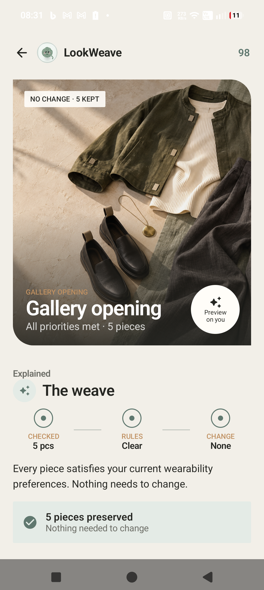

    

**The problem:** a garment can look right in a photo and still be difficult to fasten, uncomfortable while seated, incompatible with a brace, too warm for the trip, or unnecessary because a suitable piece is already owned.

**The journey:** choose a profile or make your own → ask Loomie or enter an occasion → inspect a rule-checked look and its evidence → preview the visual result → record how the clothes actually felt. External product research starts when the user explicitly asks to browse.

> A public 1–3 minute demo video and hackathon submission URL are not yet recorded in this repository. Add verified links before submission. The [screenshots](#screenshots-and-demo) below are captures from the running Android app.

**Try the Android demo:** [Download the judge APK](https://github.com/ZENODIUM/LookWeave/releases/download/v1.0-demo/app-debug.apk) · [Release notes](https://github.com/ZENODIUM/LookWeave/releases/tag/v1.0-demo). This arm64-v8a, debug-signed build uses the hosted HTTPS gateway; live features require internet and provider quota.

The APK was built from this repository with Gradle using the Android Studio JDK, Android SDK 37, and an arm64-only ABI. For the judge build, `LOOKWEAVE_BACKEND_URL` was set to `https://lookweave-api.vercel.app` before running `assembleDebug`, so the installed app talks to the hosted gateway without ADB reverse or a local Node server. Provider keys stay in the gateway environment and are not compiled into the APK.

## At a glance

| Question | LookWeave's answer |
|---|---|
| **What can I wear?** | A local, deterministic solver checks owned garments against confirmed requirements and changes conflicting pieces where possible. |
| **Why this look?** | A result card shows kept and changed garments, active rules, source evidence, and unknown facts. |
| **How might it look?** | YouCam apparel virtual try-on creates a visual preview; bundled past results make selected demo looks open quickly. |
| **Will it work in real life?** | Fit & Feel Lab records dressing tasks, time, difficulty, affected region, and notes. A generated image is never proof of comfort. |
| **What does today demand?** | Day Signals incorporates weather, UV, wind, air quality, pollen, and outing time. |
| **Do I need to buy anything?** | Loomie separates owned items, genuine gaps, and source-backed external products. |

The Android app and Node gateway are implemented. Six illustrative profiles, curated garment capsules, and bundled preview images make the core journey explorable. Live chat, voice, style analysis, fresh try-ons, and product research depend on the hosted gateway, internet, and provider availability. See [implementation status](#implementation-status) and [limitations](#current-limitations).

## Contents

- [The problem and the people](#the-problem-and-the-people)
- [Adaptive Wearability Intelligence](#adaptive-wearability-intelligence)
- [Product tour](#product-tour)
- [YouCam API integration](#youcam-api-integration-beyond-a-simple-try-on)
- [Architecture and integrations](#architecture-and-integrations)
- [Privacy and user control](#privacy-and-user-control)
- [Screenshots and demo](#screenshots-and-demo)
- [A journey with Jules](#a-journey-with-jules)
- [Validation and limitations](#validation-and-limitations)
- [Build and run](#build-and-run)
- [Roadmap and business](#roadmap-and-business)
- [Credits and references](#credits-and-references)

## The problem and the people

Getting dressed is a whole-day decision. Closures take effort. Seams and fabric can irritate. A sleeve needs to clear a device. A shoe must work for a walking commute. Coverage and modesty are personal choices. Heat, rain, indoor temperatures, schedules, and budgets matter. Yet product pages rarely offer reliable functional details, and a visual try-on cannot test dressing effort, pressure, balance, or physical fit.

### Research by the numbers

These figures explain the context; they are **not outcomes measured by LookWeave**.

| Finding | Source |
|---|---|
| About **1 in 6** people worldwide experience significant disability. | [World Health Organization, *Disability*](https://www.who.int/news-room/fact-sheets/detail/disability-and-health) |
| U.S. consumer units spent an average **$2,010 on apparel and services in 2025**. | [U.S. Bureau of Labor Statistics, Consumer Expenditures Summary](https://www.bls.gov/news.release/cesan.nr0.htm) |
| An estimated **92 million tonnes of textile waste** are generated globally each year. | [UN Environment Programme, Zero Waste Day 2025](https://www.unep.org/en/events/un-day/international-day-zero-waste-2025) |
| Textiles account for an estimated **2–8% of global greenhouse-gas emissions**. | [UNEP, Zero Waste Day key messages](https://wedocs.unep.org/bitstream/handle/20.500.11822/47015/ZWD2025_Key_messages_final.pdf?sequence=3) |

[Peer-reviewed research on clothing-related barriers experienced by people with mobility impairments](https://pubmed.ncbi.nlm.nih.gov/27890124/) reinforces why clothing usability deserves attention beyond appearance. LookWeave translates that motivation into task-based preferences and inspectable evidence. It has **not** measured reductions in textile waste, returns, or dressing difficulty.

### Six illustrative people

The app includes six **illustrative personas** with distinct ZIP codes, capsules, photos, budgets, and preferences. They are examples, not the only people the product supports. A user can also add a custom profile.

| Person | Age · occupation | Clothing challenge and preference | Example situation |
|---|---|---|---|
| **Noah** | 24 · university student | Scratchy labels, wool, tight collars; soft cotton and relaxed streetwear | Campus followed by a concert |
| **Jules** | 32 · marketing professional | Knee-brace clearance, stretch, adjustable waists, stable footwear | An important meeting while wearing a brace |
| **Kai** | 27 · graphic designer | Easier sleeves and front closures when using a forearm prosthesis | A creative client presentation |
| **Ethan** | 29 · business analyst | Walking commute, seated office time, air-conditioned rooms | Work followed by dinner |
| **Amara** | 26 · university lecturer | Personally chosen coverage and breathable layers in humidity | Lectures followed by a family gathering |
| **Maya** | 23 · part-time employee and postgraduate student | $50 monthly clothing budget; reuse before shopping | University and a work shift |

The same “meeting” request can demand different decisions: Jules may need brace clearance, Kai an accessible sleeve and front closure, and Ethan a comfortable commute. The app models stated garment tasks and preferences instead of inferring a diagnosis from a photo.

### Who this serves

LookWeave is for anyone balancing style with real-life requirements: disabled people, people with temporary injuries, sensory or dexterity needs, modest-dressing preferences, long commutes, limited budgets, or a desire to use their wardrobe more thoughtfully. Retailers could eventually benefit from reliable wearability metadata, but **no retailer partnership or commercial result is claimed** today.

## Adaptive Wearability Intelligence

LookWeave combines four inputs usually kept apart:

1. **Intent:** colours, style, occasion, presentation preferences, and budget.
2. **Function:** closures, seated comfort, sensory load, reach, grip, device clearance, shoes, materials, and custom rules.
3. **The day:** schedule plus location-level weather and environmental signals.
4. **Evidence:** garment details, retailer excerpts, personal Fit notes, and explicit unknowns.

The language model interprets requests and proposes structured actions. Android's `ConstraintSolver` decides wardrobe feasibility. It checks hard requirements against typed garment fields, ranks compatible replacements in the same category, tries to keep the original pieces, and reports unresolved gaps. An unknown source field is not treated as verified accessibility. This is a prototype decision aid, not a clinical or certified assessment.

## Product tour

### Today, wardrobe, and profiles

**Today** ranks daily looks and provides shortcuts into planning, Fit, and Day. **Wardrobe** groups owned capsule items by category and opens garment passports with fabric, closure, wearability fields, provenance, and availability. A product URL can be ingested for review; unstated attributes remain unknown. **Profile** has a collapsible at-a-glance table, editable identity and portrait, free-form preference text organized into structured fields, custom rules, evidence history, and data controls. Switching between the six seeded worlds changes their wardrobe and preferences, not merely a name.

### Filters, rules, and Weave

The filter library spans **12 categories**: closures, seated comfort, sensory comfort, footwear, reach, grip, pressure/seams, materials, mobility/devices, climate/layers, occasion, and sizing/shopping. A filter can be *must avoid*, *prefer*, or *conditional*. A natural-language rule becomes active only after the user confirms the draft. Plan accepts preset or custom occasions and can save them. **Weave** shows a full look, kept/changed counts, garment evidence, a score, triggered rules, unknowns, and an unresolved state when there is no compatible wardrobe replacement. The score is a heuristic, not a validated fit probability.

### Day Hub, Day Signals, and budget

Day Hub stores events, planned outfits, size notes, purchases, price limits, and budget notes. Outfits can be linked to events. The environmental route accepts a city or ZIP and outing time, calls Open-Meteo weather and air-quality feeds, and caches the result briefly. Day Signals presents heat, rain, gusts, UV, air quality, pollen, and an hourly outlook as concrete suggestions. These are context for a decision, not measurements of a garment. Budget is available to the agent, and the owned wardrobe remains the starting point.

### Fit & Feel Lab and optional privacy mode

Fit is the personal evidence loop: select a profile-specific garment and task, use a timer, mark a body region, rate difficulty, and save a custom comfort note. Confirmed notes and rules can inform later planning. The screen offers original-body, try-on, and **faceless mannequin** modes. Mannequin processing uses Android/ML Kit face detection and local bitmap work; detection may fail on difficult images and should be checked before sharing. Fit feedback is a personal report, not a medical diagnosis or a guarantee about other garments.

### Discovery, accessories, and nearby

Discovery has a swipe-oriented deck, save/pass actions, category filters, locally curated candidates, and an explicit live-search path. Tavily search/extract powers source-backed research and reviewed URL ingestion. Price, stock, material, and accessibility are unknown unless a source supports them. Accessory discovery covers glasses, watches, jewellery, scarves, hats, and shoes, with rejection rules for obvious irrelevant results. Nearby combines a retailer directory, ZIP-level place search, saved decisions, OpenStreetMap/Nominatim data, and a **real interactive MapLibre map** with directions. Curated cards and live research have different provenance; inspect a product source before buying.

### Style Studio and accessory detail

With explicit portrait consent, Style Studio can request YouCam **Face Attribute Analysis** and **Skin Tone Analysis**. It offers face/proportion, colour, eyewear, and jewellery directions with manual overrides. These are optional styling suggestions; the app does not infer ethnicity, religion, or diagnosis. The Accessories tab has a detail preview for rings, bracelets, watches, earrings, and necklaces. It asks for a hand/wrist photo or selfie plus a product image, then calls a corresponding YouCam 2D VTO task through the gateway. The route and UI exist; **a completed live accessory result was not verified in this documentation audit**.

### Loomie: text and voice

Loomie text chat receives structured action proposals from Gemini with Groq fallback, executes or drafts supported actions, and renders short answers with cards linking to the relevant screen. Supported paths include owned-wardrobe search, general ZIP location, Day Signals, local outfit solving, rule retrieval and drafting/editing/deletion, explicit product research, calendar and budget drafts, and observations. **Look inside** exposes an action trace. Raw tool syntax is sanitized before display; changing rules and day plans uses confirmation flows.

The **voice interface** uses ElevenLabs conversation sessions, microphone permission, a responsive wave/character treatment, transcripts, and text fallback. Transcripts can feed the text-agent path and local outfit solver for visible cards. ElevenLabs controls the spoken stream, however, so **the spoken answer is not guaranteed to match the visible solver/card answer**. Unifying these turns is open work.

#### What the agent tools actually do

| Action family | Current execution boundary |
|---|---|
| `search_wardrobe`, `get_user_location`, `get_day_signals`, `retrieve_rules` | The gateway reads supplied wardrobe/state or calls ZIP-level context providers and returns an action record. |
| `solve_outfit`, `suggest_outfit_swap` | The gateway delegates; Android runs `ConstraintSolver` and can show an outfit card. |
| `research_products` | The gateway performs Tavily source research only after an explicit browse/search/shop request; a negative instruction suppresses it. |
| `draft_rule`, `create_rule`, `edit_rule`, `delete_rule`, `apply_rules` | The gateway prepares or flags a proposal. The app's confirmation flow is required to save a change. |
| `add_calendar_event`, `update_calendar_event`, `link_outfit`, `add_purchase`, `update_price_limit`, `update_budget_note`, `update_profile_prefs`, `log_observation` | These are confirmable drafts, not silent autonomous writes. |
| `explain_plan`, `start_try_on`, `record_user_confirmation` | Present in the response contract as proposals; they need an explicit app action and are not claimed as automatic execution. |

Small but useful interactions include category tabs, search, profile switching, save/pass reset, source links, manual style corrections, consent and deletion dialogs, loading/error states, retry prompts, cached image loading, saved looks, and explainable empty states.

## Implementation status

| Capability | State | Boundary |
|---|---|---|
| Today, Wardrobe, Plan, Fit, Day, Loomie, Profile | **Implemented; main screens captured on device** | Every dialog and edge case is not instrumented. |
| Local solver and filters | **Implemented; unit tested** | 11 solver tests passed on 2026-11-02. |
| Gateway contracts and routing | **Implemented; contract tests passed** | `npm test` in `backend/` passed on 2026-11-02. |
| Hosted judge gateway | **Deployed; previous health check** | Requires internet and provider balances; see [deployment notes](docs/DEMO_DEPLOYMENT.md). |
| Apparel VTO and bundled previews | **Implemented; past results bundled** | A cache hit is not a fresh API call. |
| Face/skin analysis and accessory 2D VTO | **UI and routes implemented; limited live verification** | This audit did not spend credits on another call or establish a successful accessory result. |
| Text-agent cards and owned-look action | **Implemented; selected device flow checked** | Not every prompt/tool has end-to-end certification. |
| ElevenLabs voice | **Implemented; spoken/tool synchronization unverified** | Requires account quota, microphone, and network. |
| Discovery and nearby map | **Implemented; screens captured** | Product metadata and all map interactions need wider validation. |
| Six personas, capsules, preview cache | **Illustrative demo data** | Not a verified retail inventory. |
| Multi-user cloud security and durable storage | **Future** | No production authentication or persistent database. |

## YouCam API Integration: Beyond a Simple Try-On

Android sends selected images to the **Node gateway**, which registers and uploads files with YouCam, starts a task, polls it, and returns a result URL or structured style analysis. Provider credentials stay server-side. The visual step comes after the wardrobe decision: first understand *why* a look was chosen, then explore how it might look.

| YouCam API in code | Gateway → provider task | Input → result | Use, cache, verification |
|---|---|---|---|
| **AI Apparel Virtual Try-On, Cloth V4** | `POST /v1/try-on` → `/task/cloth-v4` | Person and garment JPEG/PNG, category → task ID and generated image URL | Try-on Studio; fingerprinted gateway cache plus Android memory/disk/bundled previews. Prior live generations produced bundled images. This audit did not issue a new paid task. Upload, task, timeout, and one-in-flight errors are handled. |
| **Face Attribute Analysis** | `POST /v1/style/analyse` → `/task/face-attr-analysis` | Consented portrait → face shape and proportion fields | Style Studio; asynchronous job polling and profile storage. UI/contract path audited; no fresh live result verified here. |
| **Skin Tone Analysis** | `POST /v1/style/analyse` → `/task/skin-tone-analysis` | Consented portrait → colour and skin-tone fields | Optional colour suggestions and manual override; no fresh live result verified here. |
| **2D Accessory VTO**: ring, bracelet, watch, earring, necklace | `POST /v1/accessory-try-on` → `/task/2d-vto/{kind}` | Hand/wrist photo or selfie plus accessory image → task ID and preview URL | Accessory Detail Lab; fingerprinted gateway cache. Route/UI exist; completed live output remains unverified in this audit. |

The gateway checks JPEG/PNG input and size and handles provider errors and timeouts. Bundled images are **past outputs**, not evidence that opening one makes a live request. YouCam provides visual exploration and optional style signals; the solver and user observations supply functional reasoning. See [API setup](docs/API_SETUP.md) and [YouCam notes](docs/YOUCAM_API_REFERENCE.md).

## Architecture and integrations

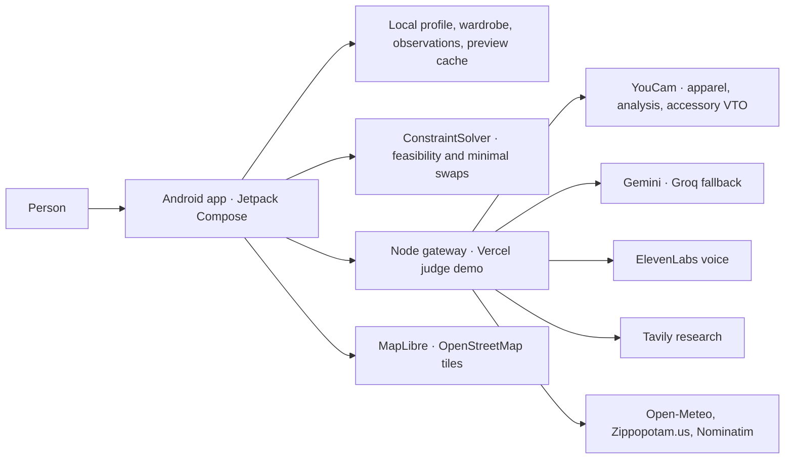

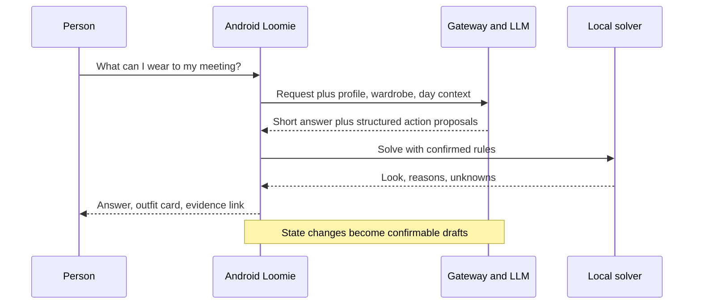

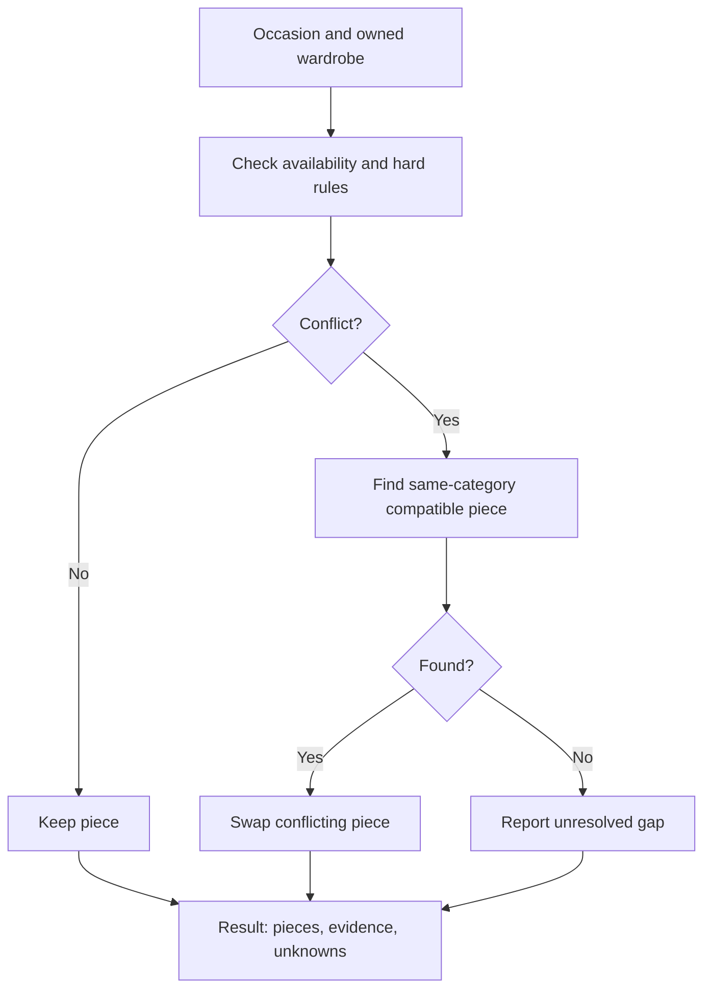

The Android source is organized into `ui/` Compose screens, `model/` garment/filter types, `data/` profiles/repositories/cache, `domain/ConstraintSolver.kt`, and `integration/LookWeaveGateway.kt`. The server starts in `backend/server.mjs`, with style and outing modules. Most personal state lives on the device. Gateway memory/files support demo sync, style jobs, and provider caches, but **Vercel function storage is ephemeral** and cannot provide durable user storage.

| Service or library | Actual role | Operational boundary |
|---|---|---|
| **YouCam API** | Apparel, face/skin, and accessory tasks | Credits, async work, and cached results. |
| **Gemini / Groq** | Agent proposal generation with fallback | Provider output varies; Android checks hard wardrobe constraints locally. Groq is an inference provider, not Grok. |
| **ElevenLabs Android SDK** | Voice session, audio, transcripts | Quota and network required; spoken-result parity incomplete. |
| **Tavily** | Product search, extraction, URL ingestion | Pages change; facts may be absent or inaccurate. |
| **Open-Meteo** | Forecast, UV, air quality, and related signals | Live data with a short gateway cache. |
| **Zippopotam.us / Nominatim / OpenStreetMap** | ZIP area and nearby place data | ZIP-level context; public place data can be incomplete. |
| **MapLibre** | Interactive map on Android | Tiles require network and attribution. |
| **ML Kit / Android face and pose detection** | On-device image/region processing | Detection varies with image quality. |

No Firecrawl or OpenCV runtime integration was found in the current app. An example environment variable by itself does not establish an integration.

## Privacy and user control

- The APK includes the gateway URL, **not provider API keys**. Selected photos for YouCam tasks travel through the gateway to the provider. Local face/pose detection is a separate on-device path.
- Portrait analysis requires explicit consent. Users can override visual suggestions, edit their profile, confirm rules, and use ZIP-level context rather than a street address.
- Source facts, personal Fit observations, and unknowns are kept separate. A try-on is a **visual preview only**, never a medical, safety, physical-fit, or accessibility certification.
- Style/profile reset and deletion controls exist where implemented. Users should inspect a faceless image before sharing; automated redaction is imperfect.
- This is a **hackathon prototype**. There is no production-grade authentication, per-user cloud isolation, durable encrypted image store, or formal security audit. Avoid uploading sensitive personal photos to a shared demo gateway.

## Screenshots and demo

These are **actual Android captures** from a connected phone, not rendered concepts. They show illustrative persona data and saved demo state; a screenshot cannot prove a fresh provider call.

| Today | Weave result | Try-on Studio |
|---|---|---|
| 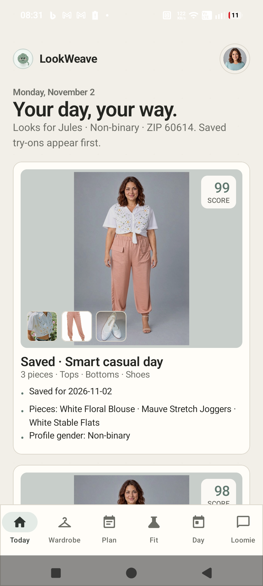 |  | 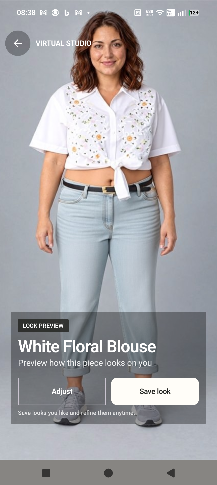 |

| Fit & Feel | Loomie answer | Nearby map |
|---|---|---|
| 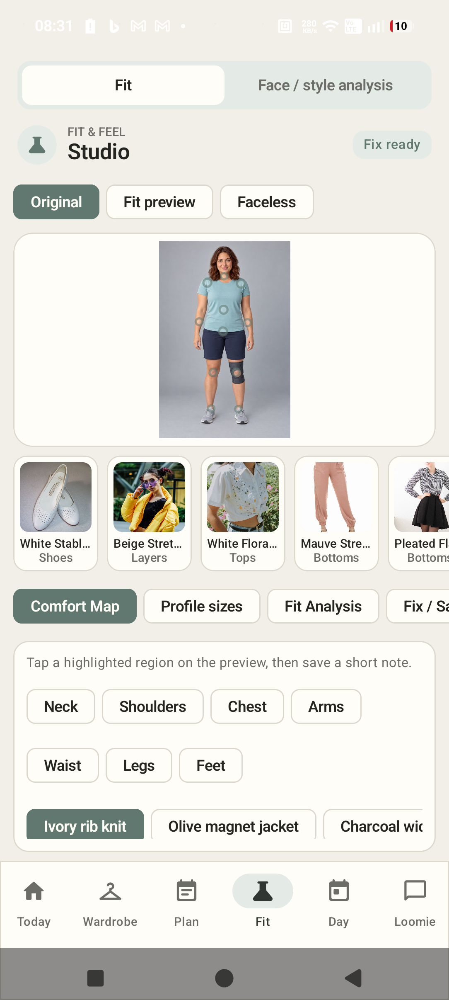 | 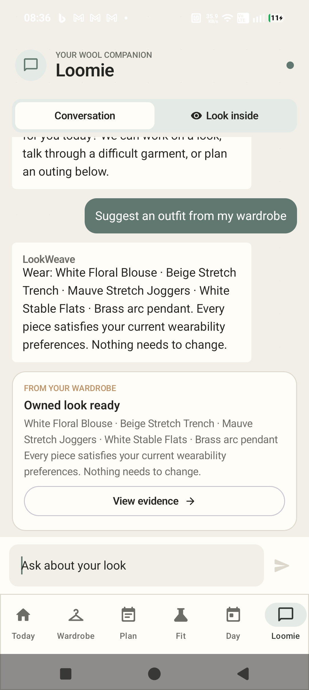 | 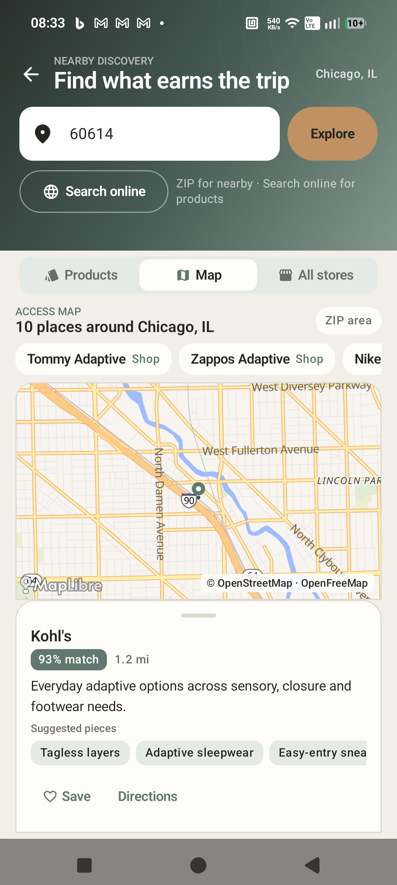 |

| Voice | Plan | Day Signals |
|---|---|---|
| 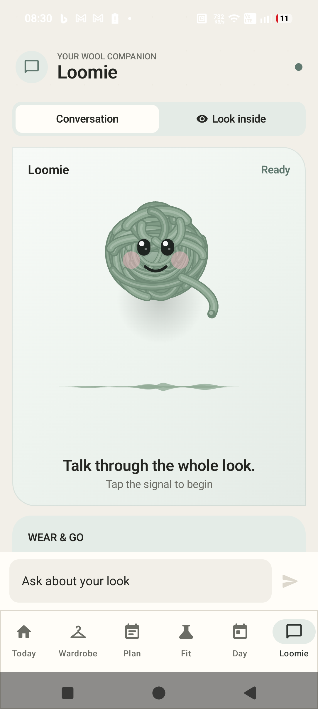 | 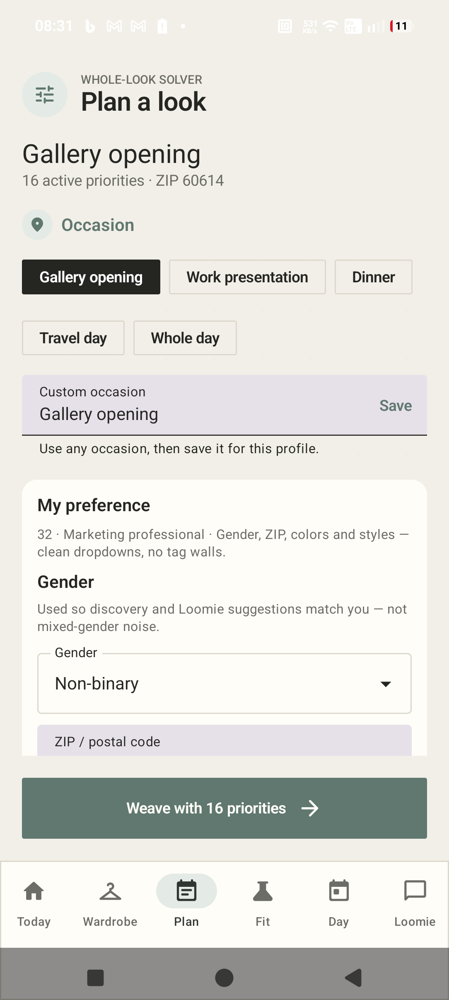 | 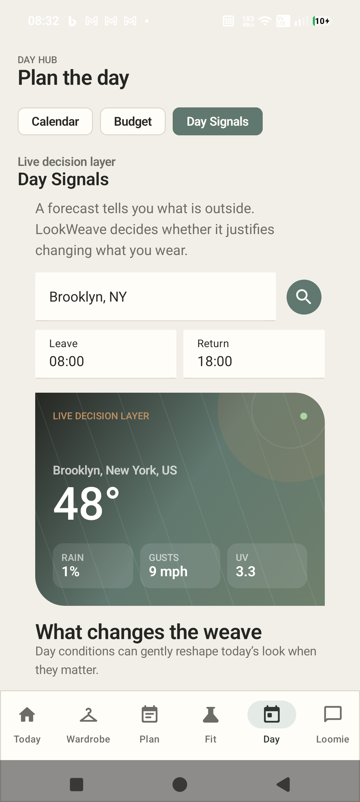 |

More phone captures: [Wardrobe](artifacts/screenshots/selected/03-wardrobe.png) · [Calendar](artifacts/screenshots/selected/08-calendar.png) · [Discovery](artifacts/screenshots/selected/10-discovery-noah.png) · [Style Studio](artifacts/screenshots/selected/13-style-studio.png) · [Accessories](artifacts/screenshots/selected/15-accessories.png) · [Profile](artifacts/screenshots/selected/19-profile.png) · [Budget](artifacts/screenshots/selected/21-budget.png). Dedicated screenshots of the **profile picker**, **agent action trace**, and **faceless mode** still need capture. Some captured demo-product metadata should be reviewed before public presentation; a card is not an independently verified retail fact.

**Video:** pending a publicly accessible 1–3 minute Android demo. The [hackathon brief](hackathon_prompt.md) requires a video and screenshots; screenshots are present here.

## A journey with Jules

1. Select **Jules**, whose profile prioritizes seated comfort, knee-brace clearance, stretch, and stable footwear.
2. Ask Loomie for a professional meeting look while wearing the brace.
3. The gateway receives the profile/wardrobe context and may propose `solve_outfit`; Android also recognizes outfit intent and runs the local solver.
4. The solver keeps compatible garments. If a same-category replacement satisfies a confirmed requirement, it swaps that piece. If none exists, it reports an unresolved gap.
5. Open the outfit card to inspect the reason, evidence, and unknowns. Open Try-on for a visual preview: a bundled result may appear immediately; a new combination requires YouCam processing.
6. Record a real dressing difficulty and comfort note in Fit & Feel Lab. That user observation remains separate evidence for future planning.
7. If the wardrobe has a genuine gap, **explicitly** ask Loomie to browse. Research then shows external sources instead of claiming a product is owned.

This is an **intended demo path**, not a claim that every branch was rerun end to end while writing this document.

## Validation and limitations

### What was checked

| Check | Result and date |
|---|---|
| Android unit test reports | **14 tests, 0 failures/errors**: solver (11), retailer directory (2), and example (1). Reports timestamped **2026-11-02** under `app/build/test-results/testDebugUnitTest/`. |
| Backend contracts | `cd backend; npm test` passed **2026-11-02**. The runner reports overall success without an individual assertion count. |
| Android screens | 16 selected screenshots from a connected physical phone cover major UI surfaces. Captures are not exhaustive functional tests. |
| APK | Debug build outputs exist; see [deployment notes](docs/DEMO_DEPLOYMENT.md). Rebuild before sharing so the APK matches current source and hosted URL. |
| Hosted providers | Earlier deployment checks recorded `/health`, rules, and text-agent responses. This README pass did not make paid YouCam calls or a live ElevenLabs session. |
| Instrumentation and lint | Test sources exist, but no current complete instrumentation or lint result was established in this audit. |

Reproducible local checks:

```powershell
cd backend
npm test
cd ..
.\gradlew.bat testDebugUnitTest assembleDebug
```

### Engineering challenges and choices

| Problem | Engineering decision | Verified boundary |
|---|---|---|
| LLMs can invent compatibility | Use typed garment fields and the Android solver for hard rules | Solver unit tests pass; real product facts still require review. |
| Retail pages omit functionality | Keep source excerpts and unknowns distinct | The route implements this policy; extraction quality varies. |
| YouCam tasks cost credits and take time | Poll asynchronously and cache by image fingerprint; bundle selected past previews | Bundled images exist; Vercel cache persistence is limited. |
| Persona state can bleed between people | Use distinct profile worlds and local profile storage | UI switching is implemented; hosted multi-user isolation is absent. |
| Voice and tool execution are different streams | Feed transcripts into Android text-agent/solver path | Visible cards exist; spoken/visible parity is unproven. |

### Current limitations

- The six personas, many garments, some discovery candidates, and bundled previews are **demonstration content**. Metadata and image/title pairs need source-by-source review before being treated as trustworthy retail inventory.
- The solver uses typed fields and heuristics. It cannot physically test fit, balance, pressure, heat, or independent dressing; missing evidence can leave a look unresolved.
- Android is the active client. The retired desktop bundle is **not** an active website, and there is no cross-device production account system.
- The hosted gateway depends on internet, quota, provider uptime, and Vercel's ephemeral function storage. It is suitable for a short judge demo, not durable public data storage.
- Text-agent tools have guardrails and selected device checks, but no complete live evaluation of every prompt and failure mode. ElevenLabs speech may diverge from visible tool-backed answers.
- Accessory VTO, current face/skin analysis results, privacy-redaction reliability, all map gestures/dialogs, and broader accessibility usability remain unverified in this audit.
- The current debug APK targets **arm64-v8a**, API 26+ devices. Wider device distribution needs another build configuration.

## Build and run

### Repository map

```text
app/                            Android Kotlin/Compose app and bundled assets
backend/                        Node gateway and contract tests
artifacts/screenshots/selected/ Physical-device screenshots
docs/                           API, product, research, and deployment notes
scripts/                        Local install and helper scripts
```

Requirements: Android Studio with a compatible JDK (JDK 11+), Android SDK **37**, an Android device/emulator at **API 26+**, and Node.js **20+**. The current APK target is arm64-v8a.

```powershell
Copy-Item backend/.env.example backend/.env
# Edit backend/.env locally with only the provider keys you intend to use.
cd backend
npm test
npm start
```

For a local USB/wireless ADB device, in another terminal at repository root:

```powershell
adb reverse tcp:8787 tcp:8787
.\gradlew.bat testDebugUnitTest assembleDebug
adb install -r app\build\outputs\apk\debug\app-debug.apk
```

`app/build.gradle.kts` reads `LOOKWEAVE_BACKEND_URL` from root `local.properties` or the environment; otherwise it defaults to `http://127.0.0.1:8787`. Set it to the deployed HTTPS gateway **before building** a judge APK. A `127.0.0.1` build needs ADB reverse and cannot work by itself on a judge's phone. See [demo deployment](docs/DEMO_DEPLOYMENT.md) and [API setup](docs/API_SETUP.md). Never commit `.env`, `local.properties`, keys, or private photos.

Local navigation, seeded wardrobe/profile data, much of the solver, and bundled previews can work without paid-provider access. Fresh chat, voice, YouCam tasks, product research, day context, and map tiles require the gateway and/or internet. Provider-free use is not feature-complete.

Before sharing an APK, rebuild with the production URL, install it on a second Android phone **without ADB reverse**, check gateway `/health`, open Plan → Weave → a bundled Try-on, and run one live text-agent request. Verify quota before recording voice or paid previews. Production release signing and distribution are still needed beyond the debug APK.

The downloadable judge APK has SHA-256 `74816F8BC25308076DD931FBC6E9F18437DD201360E67F117634592BF179E94B`.

## Roadmap and business

### Next steps

1. **Trustworthy data:** verify garment metadata and image/title pairs; improve extraction/OCR, correction, duplicate detection, and price/stock freshness.
2. **One agent turn across text and voice:** make ElevenLabs wait for the same structured result that renders the Android card, then speak that confirmed answer.
3. **Better planning:** multiple events, time windows, layers, uncertainty models, longitudinal feedback, and adjustable priorities.
4. **Research and accessibility:** test with diverse users; measure task completion, recommendation accuracy, outfit satisfaction, agent reliability, privacy-mode accuracy, and wardrobe reuse. None is claimed yet.
5. **Production foundations:** authentication, isolated user accounts, durable database/object storage, private images, deletion/consent controls, monitoring, security review, accessibility review, and broader device builds.

### Possible business models — future opportunities

| Customer | Potential value | What must be validated |
|---|---|---|
| Consumers | Free core wardrobe planning; optional paid advanced planning, insights, and extra visual previews | Repeated usefulness, accessibility, clear pricing, willingness to pay |
| Retailers | Better matching, verified wearability metadata, disclosed affiliate discovery or white-label tools | Reliable facts, measurable usefulness, transparent conflicts of interest |
| Apparel platforms | Opt-in wearability intelligence SDK/API and product information verification | Interoperability, consent, data quality, sustainable cost |

**Sensitive personal preferences and accessibility-related information should never be sold or repurposed without informed user consent.** No revenue, partnership, return reduction, or market-size result is claimed.

## Credits and references

LookWeave was created for the **YouCam API Skin AI & eCommerce VTO Hackathon** and integrates Perfect Corp / YouCam APIs. It also uses Kotlin, Jetpack Compose, Node.js, MapLibre, Google ML Kit, the ElevenLabs Android SDK, and the services above. [SiriWave's bundled license notice](app/src/main/assets/voice/LICENSE.siriwave) accompanies its asset. Third-party product imagery and persona assets need redistribution-rights review before public release. A repository-wide open-source license was **not found**; this README grants none. Add a license only after the owner chooses one and confirms asset rights.

Research: [WHO disability facts](https://www.who.int/news-room/fact-sheets/detail/disability-and-health) · [BLS consumer expenditures](https://www.bls.gov/news.release/cesan.nr0.htm) · [UNEP textile waste](https://www.unep.org/en/events/un-day/international-day-zero-waste-2025) · [UNEP textile emissions](https://wedocs.unep.org/bitstream/handle/20.500.11822/47015/ZWD2025_Key_messages_final.pdf?sequence=3) · [Kabel, Dimka & McBee-Black, *Applied Ergonomics* (2017)](https://pubmed.ncbi.nlm.nih.gov/27890124/).

More project detail: [Product reference](docs/PRODUCT_FEATURE_REFERENCE.md) · [Competitive research](docs/COMPETITIVE_RESEARCH.md) · [YouCam notes](docs/YOUCAM_API_REFERENCE.md) · [Deployment handoff](docs/DEMO_DEPLOYMENT.md).
